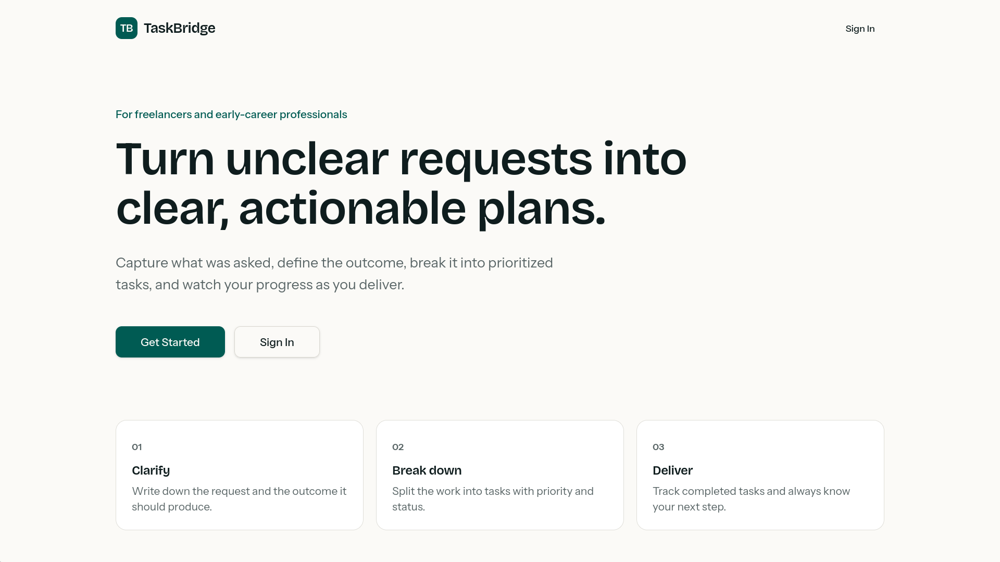
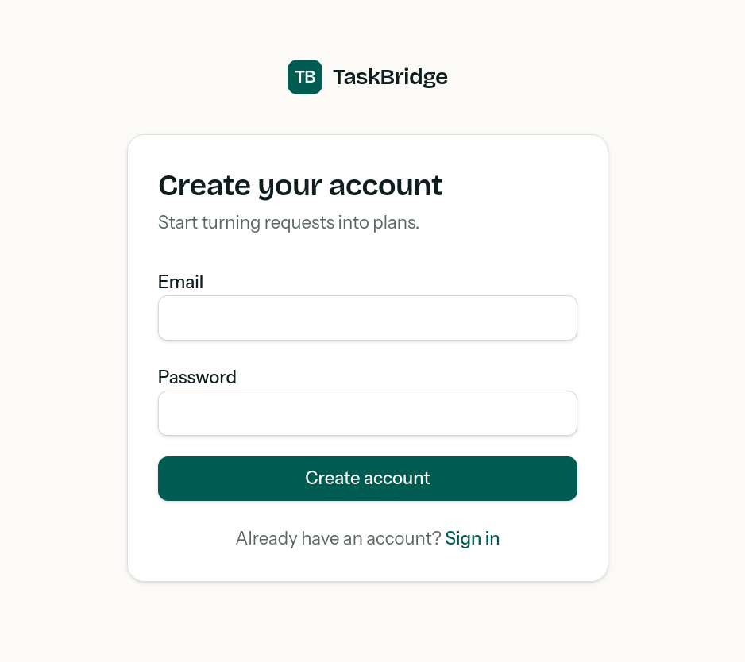
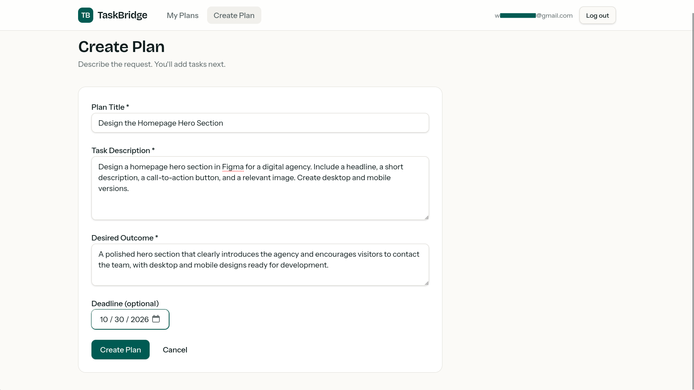
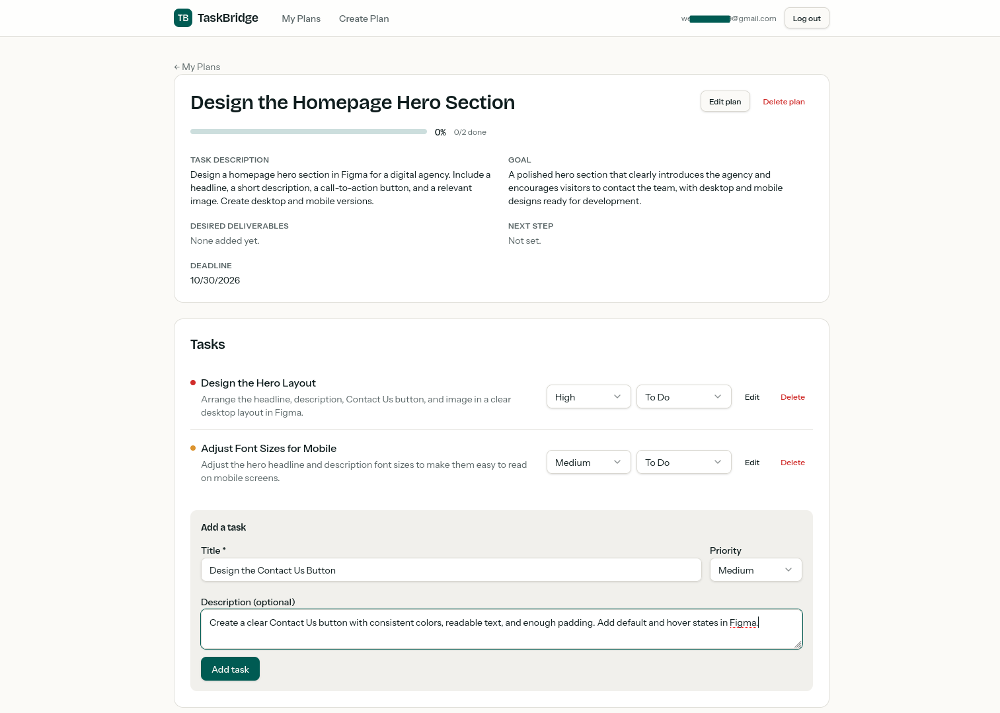
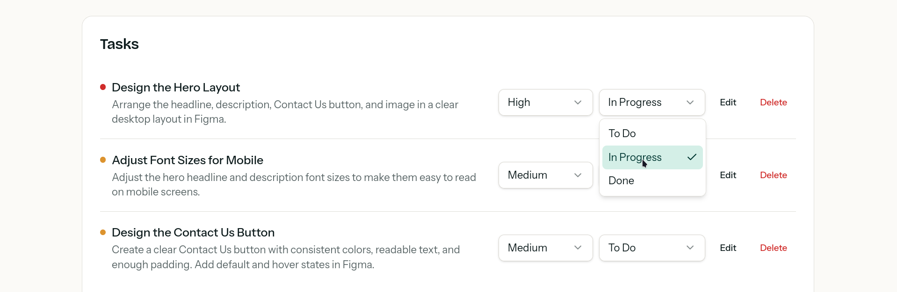

# TaskBridge

**Turn unclear requests into clear, actionable plans.**

TaskBridge helps freelancers and early-career professionals capture a work request, define the desired outcome, break it into prioritized tasks, and track delivery progress.

[Live App](https://taskbridge-weaam.lovable.app) · [Source Repository](https://github.com/WeaamR/taskbridge-weaam-lovale)



## Why TaskBridge

A client request often arrives without a clear definition of success or an actionable checklist. TaskBridge brings the original description, goal, deliverables, next step, deadline, and task list into one plan.

Plans and tasks are entered and maintained by the user. The reviewed source does not implement AI-generated plans or automatic task breakdown.

## Features

- **Account access:** email/password sign-in, account creation, confirmation resend, and password recovery flows.
- **Plan management:** create, view, edit, and delete work plans.
- **Clear outcomes:** store a description, goal, optional deadline, deliverables, and next step.
- **Task management:** add, edit, and delete tasks within a plan.
- **Priorities:** High, Medium, and Low.
- **Statuses:** To Do, In Progress, and Done.
- **Progress tracking:** display completed-task counts and a rounded completion percentage.
- **My Plans overview:** query saved plans, associated task statuses, and deadlines.
- **Feedback states:** loading skeletons, empty states, retry actions, inline validation, toasts, and delete confirmations.

## Screenshots and walkthrough

The screenshots below are ordered by the user journey rather than their upload order. The example project is **Design the Homepage Hero Section**, with an optional deadline of October 30, 2026.

### 1. Create an account

The account screen collects an email and password and links existing users to sign-in. The source also handles confirmed accounts, unconfirmed accounts, resend cooldowns, and recovery requests.



### 2. Capture the request and desired outcome

The create-plan form requires a title, task description, and desired outcome. A deadline is optional. In this example, the user describes a desktop and mobile hero design for a digital agency.



### 3. Break the work into tasks

The plan detail screen shows the brief, goal, deadline, progress, and tasks. Existing tasks include **Design the Hero Layout** and **Adjust Font Sizes for Mobile**. The add-task form is filled with **Design the Contact Us Button**.



### 4. Update task status

Each task has priority and status controls plus edit and delete actions. The screenshot shows the hero-layout task set to **In Progress**, with the other available statuses visible.



The supplied status screenshot does not show a task marked Done. Completion calculation is established by source inspection and existing test definitions, not by a screenshot of a completed plan.

## How it works

1. Sign in or create an account.
2. Open **Create Plan** and describe the request and intended outcome.
3. Add individual tasks, descriptions, and priorities.
4. Move tasks through **To Do**, **In Progress**, and **Done**.
5. Review the plan's completion percentage and outstanding work.
6. Edit the plan to maintain deliverables, the next step, and the deadline as work changes.

Progress is calculated in `src/lib/plans.ts`:

```text
progress = round(done tasks / total tasks × 100)
```

A plan with no tasks displays 0%. Tasks marked In Progress do not count as completed. For example, one Done task out of three produces 33%.

## Technology

Verified against the supplied `package.json` and source files:

| Layer | Technology |
| --- | --- |
| UI | React 19 and TypeScript |
| Application and routing | TanStack Start and TanStack Router |
| Data queries and mutations | TanStack Query |
| Styling | Tailwind CSS 4, Radix UI primitives, and reusable UI components |
| Authentication and data | Supabase Auth and Supabase tables |
| Auth input validation | Zod |
| Build | Vite with the Lovable TanStack configuration |
| Tests | Vitest, Testing Library, and jsdom |

The Vite configuration delegates plugin setup to `@lovable.dev/vite-tanstack-config`. Avoid adding duplicate React, TanStack, or Tailwind plugins without reviewing that configuration.

## Application structure

| Path | Responsibility |
| --- | --- |
| `src/routes/index.tsx` | Public landing page. |
| `src/routes/auth.tsx` | Authentication page. |
| `src/routes/reset-password.tsx` | Password recovery/reset screen. |
| `src/routes/_authenticated/route.tsx` | Authenticated application layout and access flow. |
| `src/routes/_authenticated/plans.index.tsx` | Saved-plan overview. |
| `src/routes/_authenticated/plans.new.tsx` | Plan creation. |
| `src/routes/_authenticated/plans.$id.tsx` | Plan details, editing, and task operations. |
| `src/lib/plans.ts` | Task options, progress calculation, and helpers. |
| `src/lib/signup.functions.ts` | POST server function for signup, resend, and reset requests. |
| `src/lib/signup-service.server.ts` | Account-status and auth-request handling. |
| `src/integrations/supabase/` | Browser/server clients, middleware, and generated database types. |
| `supabase/migrations/` | Supplied auth-request limiting migrations. |
| `src/test/` | Existing test definitions. |

## Data model and access requirements

Generated database types describe these tables:

| Table | Key fields |
| --- | --- |
| `plans` | `id`, `user_id`, `title`, `description`, `goal`, `deadline`, `deliverables`, `next_step`, timestamps |
| `plan_tasks` | `id`, `plan_id`, `user_id`, `title`, `description`, `priority`, `status`, `sort_order`, `created_at` |
| `signup_request_limits` | Request key, attempt count, reset time, and timestamps |

The generated types declare a task-to-plan relationship using both `plan_id` and `user_id`. However, the supplied migrations create the auth-request limiting infrastructure, not the initial `plans` and `plan_tasks` tables.

A fresh deployment therefore requires the original plan/task table definitions, defaults, constraints, ownership policies, and deletion behavior. Do not assume that applying the two included migrations reconstructs the entire application database. The browser queries rely on the deployed database to enforce ownership; the supplied files do not establish the complete plan/task row-level security configuration.

## Authentication behavior

Signup, resend, and reset actions pass through a POST server function with input validation and a same-origin check. The server calls the `check_signup_request` RPC using its privileged client. The included migrations restrict that RPC to the service role and provide database-backed request limiting.

Confirmed existing accounts are routed toward sign-in rather than another registration. Unconfirmed accounts can request another confirmation email, subject to cooldowns. The server service also handles provider rate-limit and network-error responses.

The password-reset destination is explicitly configured in `src/lib/auth-urls.ts`. For a different deployment, review that canonical URL, Supabase redirect allowlists, email confirmation settings, and the trusted client-IP header. Requests without the expected IP header share an `unknown` bucket in the server function.

These are source-level observations, not a complete security audit or verification of the live authentication service.

## Local development

Use a Node.js version compatible with the installed Vite and TanStack toolchain, plus npm.

```sh
git clone https://github.com/WeaamR/taskbridge-weaam-lovale.git
cd taskbridge-weaam-lovale
npm install
```

Configure your own Supabase environment in the local development environment:

```dotenv
# Client/build configuration
VITE_SUPABASE_URL=https://YOUR_PROJECT.supabase.co
VITE_SUPABASE_PUBLISHABLE_KEY=YOUR_PUBLISHABLE_KEY

# Server configuration
SUPABASE_URL=https://YOUR_PROJECT.supabase.co
SUPABASE_PUBLISHABLE_KEY=YOUR_PUBLISHABLE_KEY
SUPABASE_SERVICE_ROLE_KEY=YOUR_SERVER_ONLY_SERVICE_ROLE_KEY
```

The service-role key is server-only and must never use a `VITE_` prefix. Keep real values out of public documentation and commits.

Prepare the compatible database described above, apply the included auth-related migrations, and configure auth redirects. Then start development:

```sh
npm run dev
```

Use the address printed by Vite. The commands above reflect the repository's package scripts; they were not executed during this documentation review.

### Available scripts

| Command | Purpose |
| --- | --- |
| `npm run dev` | Start the development server. |
| `npm run build` | Create the production build. |
| `npm run build:dev` | Build in development mode. |
| `npm run preview` | Preview the build using Vite. |
| `npm run test` | Run the Vitest suite. |
| `npm run test:watch` | Run tests in watch mode. |
| `npm run lint` | Run ESLint. |
| `npm run format` | Format files with Prettier. |

Deployment must support the TanStack Start server functions, server-side environment variables, and configured build output; it should not be treated as a frontend-only static bundle.

## Tests and evidence

The provided archive includes tests for progress calculation, signup service behavior, signup form interactions, recovery handling, and application routing. Their presence documents intended checks, not a reported pass result.

**Reviewed:** uploaded source archive and seven screenshots. Five screenshots were selected for the public walkthrough; redundant views containing an exposed account address were omitted. The source confirms task CRUD operations, progress calculation, plan editing, auth flows, and loading/error states.

**Not executed in this review:** dependency installation, build, lint, Vitest, live account creation, database migration, or production CRUD checks. No test counts, security guarantees, or performance measurements are claimed.

Useful additional checks include cross-user data isolation, task deletion behavior when deleting a plan, reset links on each deployment, and a full progress transition from 0% to 100%.

## بالعربية

**TaskBridge** تطبيق لتنظيم طلبات العمل للمستقلين وحديثي الخبرة. يبدأ بتوثيق الطلب والنتيجة المطلوبة، ثم تقسيم العمل يدويًا إلى مهام بأولويات وحالات، مع متابعة نسبة الإنجاز وإمكانية تعديل الخطط والمهام وحذفها.

تم ترتيب الصور حسب رحلة الاستخدام: الصفحة الرئيسية، إنشاء الحساب، إنشاء الخطة، إضافة المهام، ثم تحديث الحالة. التقنيات وطريقة العمل موثقة من الكود المرفق، وليست افتراضات من الصور.

تحتاج إعادة التشغيل في بيئة جديدة إلى إعداد Supabase ومخطط جداول الخطط والمهام وسياسات الوصول، إذ لا تتضمن المهاجرات المرفقة إنشاء تلك الجداول الأساسية. الاختبارات موجودة في الكود، لكنها لم تُشغّل أثناء إعداد التوثيق.
